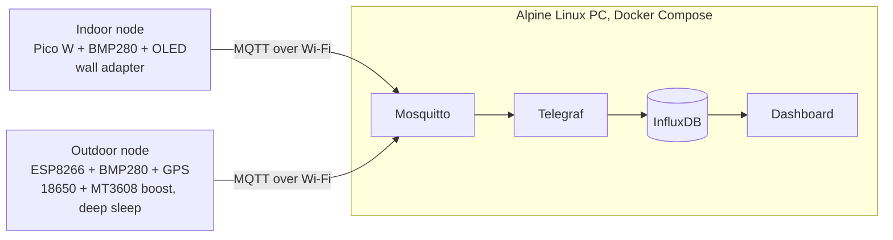

# Distributed Environmental Telemetry System

Two sensor nodes (one mains-powered indoors, one battery-powered outdoors) publish temperature, pressure and GPS data over MQTT to a self-hosted gateway running Mosquitto, Telegraf and InfluxDB in Docker on a headless Alpine Linux PC.

## What it does

- Collects temperature and pressure from a BMP280 on each node.
- Outdoor node also logs GPS position (Neo-6M).
- Outdoor node runs on one 18650 cell with a deep-sleep cycle of [30 s] to save power.
- Gateway stores everything in InfluxDB and shows it on a InfluxDB dashboard.

## Architecture

## Hardware

| Node | MCU | Sensors | Power | Firmware |
|---|---|---|---|---|
| Indoor | [Raspberry Pi Pico W](docs/images/node1.png) | BMP280, OLED | Wall adapter | C/C++ (Arduino IDE) |
| Outdoor | [NodeMCU ESP8266 v3](docs/images/node2.jpeg) | BMP280, Neo-6M GPS | 18650 Li-ion + MT3608 step-up to 5 V | C++ (Arduino IDE) |

Wiring and pin tables: see [`docs/wiring.md`](docs/wiring.md)

## Quick start

1. **Gateway:** `cd pc && cp .env.example .env` (set credentials), then `docker compose up -d`.
2. **Indoor node:** copy `secrets.h.example` to `secrets.h`, set Wi-Fi and broker details, flash from the Arduino IDE.
3. **Outdoor node:** same steps. Wake wiring: [GPIO16 to RST].
4. Open the dashboard at `http://<gateway-ip>:[port]`.

## Repo layout

- [`firmware/`](firmware/) node code
- [`pc/`](pc/) Docker Compose stack and configs
- [`docs/`](docs/) wiring, photos, notes
- [`CHANGELOG.md`](CHANGELOG.md) version history

## Known limitations

- GPS-invalid readings are skipped, which leaves gaps in the data.

## Roadmap (planned, not built yet)

- Reliability layer: watchdog, store-and-forward, backoff
- Dashboard improvements
- A `neural network based weather predictor`
- Fixed PCB's for all nodes
- A `very remote` 3rd node with an stm32 for `ultra low power`.

## References

See [`REFERENCES.md`](REFERENCES.md)
